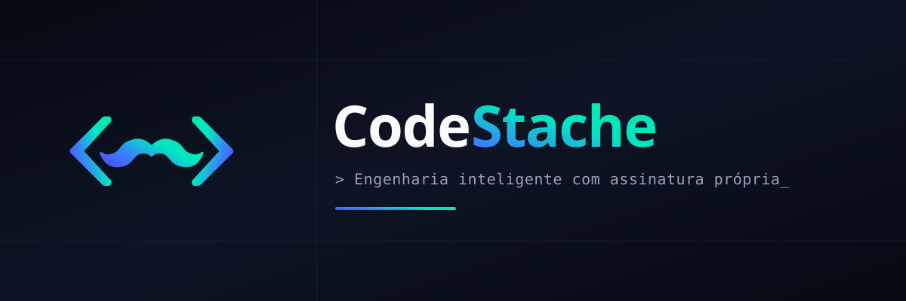

# <div align="center">  </div>

<div align="center">

# ⚡ CodeStache — Website Institucional

[](https://pages.cloudflare.com/)
[](https://github.com/codestache-dev/CodeStache-Site)
[](https://react.dev/)
[](https://www.typescriptlang.org/)
[](https://tailwindcss.com/)

> *"Engenharia inteligente com assinatura própria."*

Plataforma web institucional e comercial da **CodeStache**, software house especializada em desenvolvimento de software sob medida, automação corporativa com agentes autônomos de IA e soluções de engenharia escaláveis.

[Acessar Site Online](https://temporary-snappy-ocarina-39gzhf3.vercel.app) • [Cotações & Contato](#-cotações-sob-medida--contato-direto) • [Serviços](#-serviços-e-especialidades) • [O Fundador](#-o-fundador)

</div>

---

## 🎯 Visão Geral

O **CodeStache-Site** foi projetado seguindo as diretrizes rigorosas do **Design System CodeStache** (*Dark-First* nativo, gradientes neon, tipografia técnica e microinterações táteis). 

A aplicação apresenta a proposta de valor da software house, seu portfólio de soluções (com destaque para a plataforma **StacheHub**), o perfil do fundador e um fluxo de **Cotações Sob Medida** com despacho em tempo real diretamente para o WhatsApp comercial oficial.

---

## ✨ Funcionalidades & Seções

- **🎨 Dark Mode Nativo & Light Mode Institucional:** Fundo Obsidian Code (`#0B0F19`) e cartões Slate Terminal (`#151C2C`), com alternância fluida de tema persistida em `localStorage`.
- **🚀 Hero Section Interativo:** Orbes com gradientes fluídos animados via Framer Motion, status de disponibilidade ao vivo (`Live Ping`) e mock de terminal de código sintático com métricas de entrega.
- **🏛️ Sobre a Empresa (Cultura & Pilares):** Propósito, Missão, Visão e os 5 valores inegociáveis (*Pragmatismo Inteligente*, *Automação com Propósito*, *Assinatura Própria*, *Conhecimento Compartilhado* e *Inovação Incremental*).
- **💼 Vitrine de Serviços:**
  - Desenvolvimento de Software Sob Medida (Web, Mobile, SaaS, Arquitetura Hexagonal/.NET/React).
  - Agentes de IA & Automação Corporativa (LLMs, RAG, pipelines autônomos).
  - Consultoria de Arquitetura, Cloud & Docker.
  - Integrações Críticas de Sistemas & APIs em Tempo Real (SignalR, WebSockets).
- **📦 Showcase de Produtos (Flagship StacheHub):** Apresentação da plataforma Help Desk corporativa desenvolvida pela CodeStache com SLAs inteligentes, WebSockets e auditoria em tempo real.
- **👨‍💻 O Fundador:** Apresentação profissional de **João Vitor Dias** (Full Stack Engineer & Arquiteto de Soluções), stack tecnológica, histórico de liderança técnica e links diretos (GitHub e LinkedIn).
- **📋 Cotações Sob Medida & Contato Direto:** Formulário técnico onde o cliente detalha a demanda, prazos desejados e requisitos, despachando o briefing estruturado diretamente para o WhatsApp comercial oficial (`+55 62 9 8219-3504`) para atendimento personalizado da engenharia.

---

## 🛠️ Stack Tecnológica

| Camada | Tecnologia | Finalidade |
| :--- | :--- | :--- |
| **Framework UI** | [React 19](https://react.dev/) | Renderização moderna de componentes reativos. |
| **Tipagem** | [TypeScript 5.7](https://www.typescriptlang.org/) | Tipagem estrita em modo `strict`, zero `any`. |
| **Build Tool** | [Vite 6](https://vite.dev/) | HMR ultra-rápido e empacotamento com Rollup. |
| **Estilização** | [Tailwind CSS v4](https://tailwindcss.com/) | Engine moderna `@import "tailwindcss"` com tokens `@theme`. |
| **Animações** | [Framer Motion 11](https://motion.dev/) | Transições no scroll, orbes gradientes e interações táteis. |
| **Ícones** | [Lucide React](https://lucide.dev/) | Conjunto consistente de ícones vetoriais. |
| **Qualidade & Linter** | [oxlint](https://oxc.rs/) | Linter de altíssima performance para garantir zero warnings e erros. |
| **Hospedagem** | [Vercel](https://vercel.com/) | Deploy contínuo com CDN global Edge. |

---

## 🎨 Design System CodeStache

### Paleta de Cores (Tokens Dark-First)

| Token | Valor Hex | Aplicação |
| :--- | :--- | :--- |
| **Obsidian Code** | `#0B0F19` | Fundo principal da aplicação |
| **Slate Terminal** | `#151C2C` | Superfície de cartões, modais e containers |
| **Electric Indigo** | `#6366F1` | Cor primária, botões de ação e destaques principais |
| **Cyber Mint** | `#10B981` | Cor secundária, badges de IA e status ativos |
| **Terminal Blue** | `#3B82F6` | Ponto intermediário do gradiente de assinatura |
| **Border Subtle** | `#1E293B` | Linhas divisórias e contornos |

### Gradiente Oficial Flow
```css
linear-gradient(135deg, #6366F1 0%, #3B82F6 50%, #10B981 100%)
```

### Tipografia
- **Títulos & Logotipos:** `Space Grotesk` (Pesos: 700 Bold, 500 Medium)
- **Interface & Leitura:** `Inter` (Pesos: 400 Regular, 500 Medium, 600 SemiBold)
- **Códigos, Tags & Métricas:** `JetBrains Mono`

---

## 🚀 Como Executar Localmente

### Pré-requisitos
- [Node.js](https://nodejs.org/) versão 18+ ou 20+
- `npm` ou `pnpm`

### Instalação

1. Clone o repositório:
```bash
git clone https://github.com/codestache-dev/CodeStache-Site.git
cd CodeStache-Site
```

2. Instale as dependências:
```bash
npm install
```

3. Inicie o servidor de desenvolvimento:
```bash
npm run dev
```
O projeto estará acessível em `http://localhost:5173`.

---

## 📦 Scripts Disponíveis

| Comando | Descrição |
| :--- | :--- |
| `npm run dev` | Inicia o servidor local de desenvolvimento Vite com HMR. |
| `npm run build` | Validação estrita do TypeScript (`tsc -b`) e geração do bundle em `dist/`. |
| `npm run lint` | Executa o `oxlint` para verificação estática de código. |
| `npm run preview` | Pré-visualiza localmente a versão final gerada em `dist/`. |

---

## 🌐 Deploy em Produção (Cloudflare Pages)
 
O projeto é otimizado para sites estáticos corporativos no **Cloudflare Pages**:
- **Framework Preset:** `Vite`
- **Build Command:** `npm run build`
- **Output Directory:** `dist`
- **Branch de Produção:** `master`
- **Arquivos Especiais Inclusos:**
  - `public/_headers`: Caching imutável para assets e políticas rígidas de segurança (HSTS, CSP, X-Frame-Options).
  - `public/_redirects`: Fallback SPA para navegação fluida em rotas sem recarregar a página.

### Como Conectar no Cloudflare Pages:
1. Acesse o painel da Cloudflare: [dash.cloudflare.com](https://dash.cloudflare.com/) ➔ **Workers & Pages**.
2. Clique em **Create application** ➔ aba **Pages** ➔ **Connect to Git**.
3. Selecione a organização **`codestache-dev`** e o repositório **`CodeStache-Site`**.
4. Defina o preset como **Vite** e clique em **Save and Deploy**. Todo push na branch `master` gerará deploy contínuo em menos de 15 segundos!

---

## 👤 Autor

**João Vitor Dias**  
*Full Stack Engineer & Arquiteto de Soluções*  
- **GitHub:** [@JoaoVitorDiass](https://github.com/JoaoVitorDiass)  
- **LinkedIn:** [João Vitor Dias](https://www.linkedin.com/in/joaovitor-diass)  
- **WhatsApp:** [+55 (62) 98219-3504](https://wa.me/5562982193504)  
- **Organização:** [CodeStache](https://github.com/codestache-dev)

---

<div align="center">
<sub>Construído com excelência pela <strong>CodeStache</strong> • 2026</sub>
</div>
